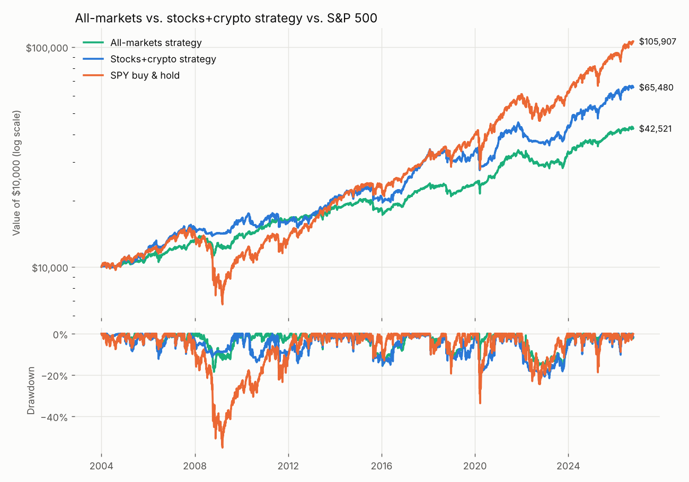

# All-markets stress test

Data through **2026-10-13**. Research only, not financial advice; past results
do not predict future ones. Costs and next-day fills are included as in `REPORT.md`.

## 1. Every market on its own: does the trend filter help?

For each market: just holding it vs. holding it only while it's above its 200-day
average (otherwise cash). The trend filter **improved risk-adjusted return (Sharpe) in
13 of 24 markets** and **reduced the worst drop in 24 of 24**.

| Market | Class | Since | Hold: return/yr | Hold: worst drop | Trend: return/yr | Trend: worst drop | Sharpe hold → trend |
|---|---|---|---|---|---|---|---|
| S&P 500 (SPY) | US stocks | 2004 | 11.3% | -55.2% | 9.3% | -29.2% | 0.56 → 0.63 |
| Nasdaq 100 (QQQ) | US stocks | 2004 | 15.7% | -53.4% | 12.0% | -28.6% | 0.70 → 0.65 |
| Russell 2000 small caps (IWM) | US stocks | 2004 | 8.9% | -58.6% | 5.4% | -34.1% | 0.40 → 0.29 |
| Developed ex-US (EFA) | International stocks | 2004 | 6.6% | -61.0% | 5.4% | -35.3% | 0.32 → 0.31 |
| Emerging markets (EEM) | International stocks | 2004 | 7.9% | -66.4% | 7.0% | -48.5% | 0.35 → 0.36 |
| Europe (VGK) | International stocks | 2005 | 6.1% | -63.6% | 4.5% | -37.5% | 0.29 → 0.24 |
| Japan (EWJ) | International stocks | 2004 | 5.9% | -54.5% | 3.8% | -35.4% | 0.29 → 0.20 |
| 20+yr Treasuries (TLT) | Bonds | 2004 | 2.7% | -48.4% | 2.8% | -29.6% | 0.13 → 0.13 |
| 7-10yr Treasuries (IEF) | Bonds | 2004 | 2.9% | -23.9% | 2.4% | -17.5% | 0.18 → 0.11 |
| Inflation-linked Treasuries (TIP) | Bonds | 2004 | 3.2% | -14.5% | 3.3% | -11.2% | 0.23 → 0.30 |
| Investment-grade corporates (LQD) | Bonds | 2004 | 3.7% | -25.0% | 3.5% | -21.8% | 0.25 → 0.29 |
| High-yield corporates (HYG) | Bonds | 2008 | 5.0% | -34.2% | 3.8% | -22.0% | 0.37 → 0.37 |
| Gold (GLD) | Commodities | 2005 | 10.7% | -45.6% | 8.5% | -38.3% | 0.54 → 0.48 |
| Silver (SLV) | Commodities | 2007 | 7.1% | -76.3% | 5.4% | -64.1% | 0.32 → 0.27 |
| Broad commodities (DBC) | Commodities | 2006 | 2.7% | -76.4% | 4.7% | -48.3% | 0.14 → 0.26 |
| Crude oil (USO) | Commodities | 2007 | -4.2% | -98.2% | 2.4% | -75.6% | 0.03 → 0.14 |
| Agriculture (DBA) | Commodities | 2007 | 0.9% | -68.0% | 3.6% | -39.1% | 0.03 → 0.22 |
| US REITs (VNQ) | Real estate | 2005 | 6.4% | -73.1% | 2.8% | -56.8% | 0.29 → 0.14 |
| US dollar index (UUP) | Currencies | 2007 | 2.0% | -22.2% | 1.8% | -21.0% | 0.09 → 0.06 |
| Euro (FXE) | Currencies | 2006 | -0.4% | -43.3% | 1.3% | -15.8% | -0.21 → -0.08 |
| Japanese yen (FXY) | Currencies | 2007 | -2.4% | -57.0% | -0.4% | -30.4% | -0.34 → -0.24 |
| Bitcoin (BTC-USD) | Crypto | 2015 | 66.5% | -83.0% | 67.9% | -70.2% | 1.09 → 1.18 |
| Ethereum (ETH-USD) | Crypto | 2018 | 30.4% | -78.4% | 14.1% | -74.2% | 0.71 → 0.49 |
| Solana (SOL-USD) | Crypto | 2021 | 79.2% | -96.1% | 78.6% | -78.5% | 1.07 → 1.11 |

## 2. Portfolios, full history

The **all-markets strategy** uses the same rules on 15 markets:
stocks SPY, QQQ, IWM, EFA, EEM; bonds/commodities/real estate
IEF, TLT, TIP, LQD, GLD, DBC, VNQ; crypto BTC-USD, ETH-USD, SOL-USD;
max 25% per asset.

| Portfolio | CAGR | Volatility | Sharpe | Sortino | Max drawdown | Longest drawdown (days) | Calmar | Worst year | Best year | Positive years | Positive months |
|---|---|---|---|---|---|---|---|---|---|---|---|
| All-markets strategy | 6.6% | 7.9% | 0.61 | 1.11 | -18.5% | 578 | 0.35 | -13.6% | 19.0% | 82.6% | 63.4% |
| Stocks+crypto strategy | 8.6% | 11.7% | 0.60 | 0.93 | -21.6% | 566 | 0.40 | -15.3% | 35.6% | 73.9% | 63.0% |
| SPY buy & hold | 10.9% | 18.6% | 0.55 | 0.80 | -55.2% | 1,223 | 0.20 | -36.8% | 32.3% | 87.0% | 66.7% |
| 60/40 SPY/IEF | 8.1% | 10.5% | 0.61 | 1.00 | -32.2% | 704 | 0.25 | -17.7% | 21.8% | 87.0% | 67.0% |
| All markets, equal weight, no rules | 14.8% | 15.2% | 0.86 | 1.29 | -38.0% | 576 | 0.39 | -32.4% | 114.2% | 82.6% | 60.4% |

## 3. Crashes, recoveries and sideways markets

Total return over each period (blank = portfolio not yet running).

| Period | All-markets strategy | Stocks+crypto strategy | SPY buy & hold | 60/40 SPY/IEF | All markets, equal weight, no rules |
|---|---|---|---|---|---|
| 2008 financial crisis | -4.1% | -8.0% | -55.2% | -32.2% | -31.8% |
| 2010 euro crisis / flash crash | -1.7% | -11.6% | -15.7% | -6.9% | -6.4% |
| 2011 US downgrade | -1.1% | -9.2% | -18.6% | -6.6% | -8.8% |
| 2015-16 China & oil crash | -12.2% | -13.8% | -13.0% | -5.4% | -5.5% |
| 2018 crypto winter | -8.6% | -6.4% | -5.2% | -2.3% | -19.0% |
| 2018 Q4 rate scare | -11.2% | -12.3% | -19.3% | -10.5% | -12.3% |
| 2020 Covid crash | -7.1% | -19.0% | -33.7% | -18.7% | -23.1% |
| 2022 inflation & rate hikes | -11.8% | -14.3% | -24.5% | -20.7% | -30.9% |
| 2025 tariff shock | -6.3% | -12.1% | -18.8% | -10.6% | -14.7% |
| Recovery: Mar 2009 - Mar 2010 | 14.6% | 17.8% | 71.9% | 38.9% | 48.3% |
| Recovery: Covid rebound 2020 | 21.8% | 29.8% | 69.8% | 37.4% | 91.3% |
| Sideways: 2015 | -7.4% | -5.5% | 1.3% | 1.6% | -0.0% |

## 4. By market regime

Average monthly return, grouping every month since 2004 by what the S&P 500 did.

| Avg monthly return when the stock market is… | Falling (SPY < -3%) — 39 months | Flat (±3%) — 153 months | Rising (SPY > +3%) — 81 months |
|---|---|---|---|
| All-markets strategy | -2.0% | 0.5% | 1.9% |
| Stocks+crypto strategy | -3.4% | 0.6% | 3.0% |
| SPY buy & hold | -6.4% | 0.5% | 5.4% |
| 60/40 SPY/IEF | -3.5% | 0.4% | 3.2% |
| All markets, equal weight, no rules | -4.2% | 0.8% | 4.7% |

## 5. Consistency: how often was a holding period profitable?

Share of all rolling 1-, 3- and 5-year windows (start on any day) that ended in profit.

| Portfolio | 1-yr windows positive | Worst 1 yr | 3-yr windows positive | Worst 3 yrs | 5-yr windows positive | Worst 5 yrs |
|---|---|---|---|---|---|---|
| All-markets strategy | 80.8% | -16.5% | 100.0% | -0.1% | 100.0% | 6.4% |
| Stocks+crypto strategy | 74.0% | -19.5% | 99.8% | -3.5% | 100.0% | 1.4% |
| SPY buy & hold | 84.6% | -47.4% | 87.9% | -43.5% | 92.7% | -35.5% |
| 60/40 SPY/IEF | 87.8% | -27.9% | 94.1% | -19.1% | 99.4% | -11.9% |
| All markets, equal weight, no rules | 85.1% | -37.8% | 97.7% | -15.7% | 100.0% | 2.5% |

## 6. Calendar years

| Year | All-markets strategy | Stocks+crypto strategy | SPY buy & hold | 60/40 SPY/IEF | All markets, equal weight, no rules |
|---|---|---|---|---|---|
| 2004 | 5.3% | 11.1% | 10.7% | 6.5% | 10.6% |
| 2005 | 5.3% | 5.7% | 4.8% | 4.1% | 9.4% |
| 2006 | 8.2% | 17.1% | 15.8% | 10.4% | 14.7% |
| 2007 | 10.1% | 9.5% | 5.1% | 7.4% | 12.0% |
| 2008 | -3.4% | -5.3% | -36.8% | -17.7% | -18.7% |
| 2009 | 9.1% | 14.9% | 26.4% | 13.2% | 22.2% |
| 2010 | 9.7% | -0.3% | 15.1% | 13.5% | 16.7% |
| 2011 | 6.9% | -2.6% | 1.9% | 7.9% | 5.4% |
| 2012 | 4.9% | 6.5% | 16.0% | 11.3% | 12.2% |
| 2013 | 11.0% | 23.5% | 32.3% | 15.6% | 3.8% |
| 2014 | 3.5% | 5.0% | 13.5% | 11.9% | 4.4% |
| 2015 | -7.0% | -5.7% | 1.2% | 1.7% | -0.1% |
| 2016 | 7.9% | 14.0% | 12.0% | 7.7% | 16.1% |
| 2017 | 18.9% | 35.6% | 21.7% | 13.7% | 52.3% |
| 2018 | -8.4% | -5.4% | -4.6% | -2.0% | -17.1% |
| 2019 | 11.5% | 10.8% | 31.2% | 21.8% | 27.6% |
| 2020 | 16.3% | 8.6% | 18.3% | 16.6% | 63.9% |
| 2021 | 19.0% | 17.2% | 28.7% | 15.1% | 114.2% |
| 2022 | -13.6% | -15.3% | -18.2% | -16.6% | -32.4% |
| 2023 | 16.2% | 20.8% | 26.2% | 16.8% | 50.7% |
| 2024 | 9.6% | 19.4% | 24.9% | 14.2% | 24.4% |
| 2025 | 11.1% | 15.5% | 17.7% | 13.9% | 12.8% |
| 2026 | 5.0% | 8.7% | 15.0% | 7.2% | 6.9% |
