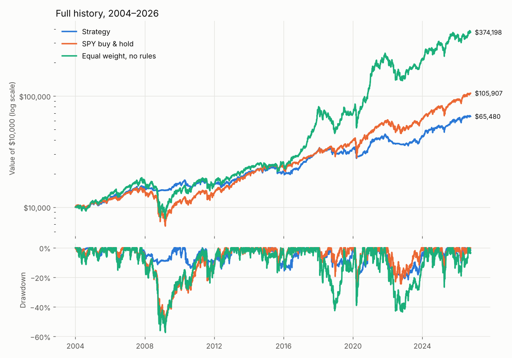
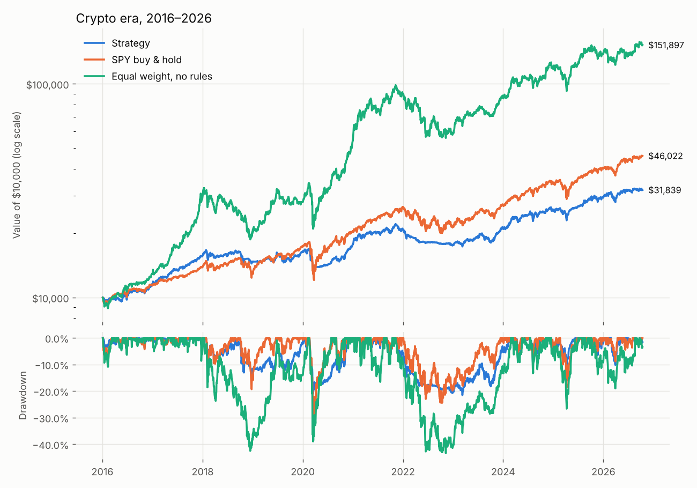

# Backtest report

Generated from data through **2026-10-13**. Past performance does not predict
future results. This is a research tool, not financial advice.

Strategy settings: trend filter 200-day SMA, inverse-volatility weights
(60-day), target volatility 12%, crypto cap 20%,
single-asset cap 35%, no leverage, costs 5 bps stocks /
25 bps crypto per trade, fills at next day's close.

## Full history

| Metric | Strategy | SPY buy & hold | Equal weight, no rules |
|---|---|---|---|
| CAGR | 8.6% | 10.9% | 17.2% |
| Volatility | 11.7% | 18.6% | 24.5% |
| Sharpe | 0.60 | 0.55 | 0.70 |
| Sortino | 0.93 | 0.80 | 0.99 |
| Max drawdown | -21.6% | -55.2% | -57.3% |
| Longest drawdown (days) | 566 | 1,223 | 1,226 |
| Calmar | 0.40 | 0.20 | 0.30 |
| Worst year | -15.3% | -36.8% | -40.4% |
| Best year | 35.6% | 32.3% | 124.3% |
| Positive years | 73.9% | 87.0% | 82.6% |
| Positive months | 63.0% | 66.7% | 63.0% |

## Crypto era (since 2016)

| Metric | Strategy | SPY buy & hold | Equal weight, no rules | BTC buy & hold |
|---|---|---|---|---|
| CAGR | 11.3% | 15.2% | 28.7% | 62.9% |
| Volatility | 12.1% | 17.7% | 26.5% | 65.4% |
| Sharpe | 0.81 | 0.80 | 1.03 | 1.05 |
| Sortino | 1.14 | 1.08 | 1.41 | 1.49 |
| Max drawdown | -21.6% | -33.7% | -43.4% | -83.0% |
| Longest drawdown (days) | 566 | 488 | 576 | 741 |
| Calmar | 0.53 | 0.45 | 0.66 | 0.76 |
| Worst year | -15.3% | -18.2% | -34.4% | -74.5% |
| Best year | 35.6% | 31.2% | 124.3% | 1424.7% |
| Positive years | 81.8% | 81.8% | 81.8% | 63.6% |
| Positive months | 64.3% | 71.3% | 64.3% | 56.6% |

## Calendar-year returns

| Year | Strategy | SPY buy & hold | Equal weight, no rules | BTC buy & hold |
|---|---|---|---|---|
| 2004 | 11.1% | 10.7% | 14.3% |  |
| 2005 | 5.7% | 4.8% | 11.2% |  |
| 2006 | 17.1% | 15.8% | 19.7% |  |
| 2007 | 9.5% | 5.1% | 12.8% |  |
| 2008 | -5.3% | -36.8% | -40.4% |  |
| 2009 | 14.9% | 26.4% | 40.7% |  |
| 2010 | -0.3% | 15.1% | 17.5% |  |
| 2011 | -2.6% | 1.9% | -6.1% |  |
| 2012 | 6.5% | 16.0% | 18.0% |  |
| 2013 | 23.5% | 32.3% | 24.3% |  |
| 2014 | 5.0% | 13.5% | 2.1% | -30.0% |
| 2015 | -5.7% | 1.2% | 5.3% | 34.5% |
| 2016 | 14.0% | 12.0% | 26.7% | 123.2% |
| 2017 | 35.6% | 21.7% | 124.3% | 1424.7% |
| 2018 | -5.4% | -4.6% | -30.6% | -74.5% |
| 2019 | 10.8% | 31.2% | 39.5% | 92.2% |
| 2020 | 8.6% | 18.3% | 94.3% | 303.2% |
| 2021 | 17.2% | 28.7% | 64.0% | 59.7% |
| 2022 | -15.3% | -18.2% | -34.4% | -64.1% |
| 2023 | 20.8% | 26.2% | 48.9% | 153.6% |
| 2024 | 19.4% | 24.9% | 34.9% | 121.9% |
| 2025 | 15.5% | 17.7% | 17.2% | -6.3% |
| 2026 | 8.7% | 15.0% | 10.5% | -5.0% |

## Robustness: does it only work with one lucky setting?

Each row reruns the full history with different parameters. If results collapsed away
from the default (200 days, 12%), the strategy would be curve-fit.

| Trend lookback | Target vol | CAGR | Max drawdown | Sharpe | Worst year |
|---|---|---|---|---|---|
| 100 | 8% | 6.5% | -17.2% | 0.58 | -12.7% |
| 100 | 12% | 8.5% | -21.6% | 0.62 | -15.6% |
| 100 | 16% | 10.0% | -24.5% | 0.66 | -17.7% |
| 150 | 8% | 6.6% | -16.9% | 0.58 | -12.4% |
| 150 | 12% | 8.4% | -21.1% | 0.59 | -14.4% |
| 150 | 16% | 9.5% | -25.1% | 0.61 | -16.0% |
| 200 | 8% | 6.6% | -17.4% | 0.58 | -12.1% |
| 200 | 12% | 8.6% | -21.6% | 0.60 | -15.3% |
| 200 | 16% | 9.9% | -26.1% | 0.62 | -17.9% |
| 250 | 8% | 5.9% | -22.3% | 0.50 | -10.1% |
| 250 | 12% | 7.4% | -26.6% | 0.50 | -14.0% |
| 250 | 16% | 8.6% | -27.8% | 0.54 | -16.9% |

## How the money was usually allocated

Average weight over all rebalances (cash = SHY):

| Asset | Avg weight |
|---|---|
| SHY | 32.6% |
| SPY | 17.5% |
| QQQ | 14.0% |
| EFA | 13.2% |
| IWM | 10.9% |
| EEM | 9.0% |
| BTC-USD | 1.9% |
| ETH-USD | 0.8% |

Average monthly turnover: 17.0% of the portfolio.

## Most recent allocation (2026-10-01)

| Asset | Weight |
|---|---|
| SPY | 19.4% |
| EFA | 17.1% |
| SHY | 16.8% |
| IWM | 16.3% |
| QQQ | 11.4% |
| EEM | 9.2% |
| BTC-USD | 5.6% |
| ETH-USD | 4.1% |
